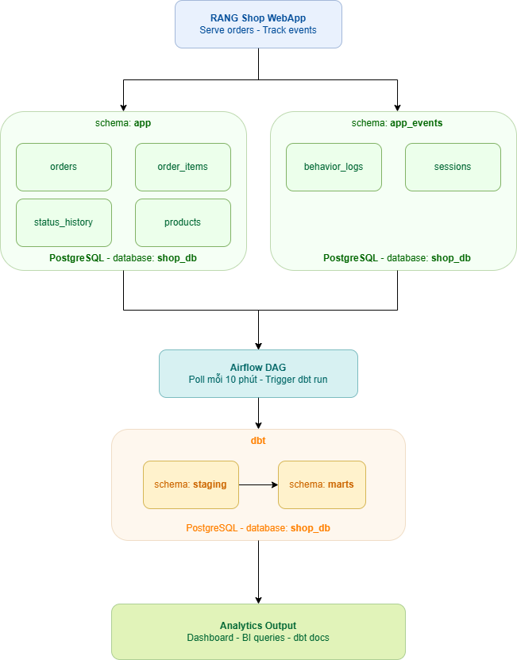

# Rang Shop Data Pipeline

A data engineering pipeline built on top of [Rang Shop WebApp](https://github.com/kuromine19/RANG-Shop-WebApp) — a mock Vietnamese coffee & tea e-commerce platform.

## Stack

- **PostgreSQL** — data warehouse (`shopdb`)
- **dbt** — data transformation (staging → marts)
- **Apache Airflow** — pipeline orchestration (poll every 10 minutes)

## Data Flow

